<a href="https://portfolio-ankit-kumar-cse.vercel.app">
  
</a>

  
  
  
  




<!-- OPINIS -->

  
  

<!-- GREPWISE -->

  
  

<!-- REPLICA -->
<a href="https://github.com/arsonic-dev/Replica">
  
</a>

  
  

<!-- SKYSIGHT -->

  
  


<a href="https://www.linkedin.com/in/ankit-kumar-btech-cse/details/certifications/"></a>

  
  
  
  


  

  
  


  
  
  
  

<a href="https://portfolio-ankit-kumar-cse.vercel.app">
  
</a>
